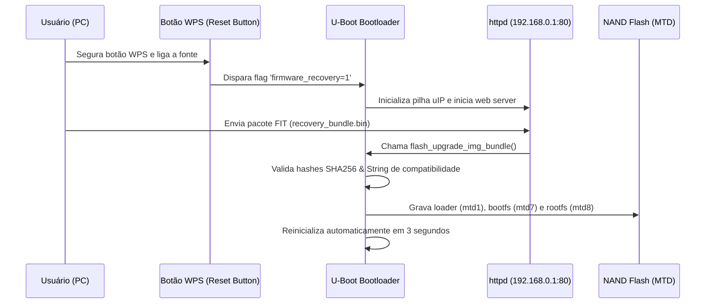

# Guia de Recuperação e Desbricagem via Rescue Mode (WPS Web UI)
## TP-Link Archer BE220 & Archer BE230 (Broadcom BCM6764 / BCA SDK)

Este guia documenta o procedimento completo de recuperação ("unbrick") do TP-Link Archer BE220 utilizando o **Modo de Recuperação Nativo do U-Boot** (HTTP Rescue Server), sem necessidade de abertura de gabinete ou cabos seriais (UART).

---

## 1. Visão Geral da Arquitetura de Recuperação

O U-Boot da Broadcom (`bcmbca`) implementa um mini servidor HTTP embutido (`httpd.c` / `bcmbca_net.c`) que escuta na porta 80 quando uma condição de falha ou combinação de botões de hardware é detectada.



---

## 2. Como Entrar no Rescue Mode

> [!IMPORTANT]
> A placa de rede do seu computador deve ser configurada manualmente com um IP estático na faixa `192.168.0.x`. O servidor HTTP do U-Boot não possui serviço DHCP.

### Passo 1: Configuração de Rede no Windows
1. Abra as **Conexões de Rede** do Windows (`ncpa.cpl`).
2. Clique com o botão direito na interface Ethernet $\rightarrow$ **Propriedades** $\rightarrow$ **Protocolo IP Versão 4 (TCP/IPv4)**.
3. Configure os seguintes valores estáticos:
   - **Endereço IP:** `192.168.0.2`
   - **Máscara de sub-rede:** `255.255.255.0`
   - **Gateway padrão:** `192.168.0.1`

### Passo 2: Inicialização em Modo Rescue
1. Desligue o roteador da fonte de energia (ou pelo botão de power traseiro).
2. Conecte um cabo de rede da porta LAN 1 do roteador à porta de rede do seu computador.
3. **Mantenha o botão WPS pressionado**.
4. Ligue a energia mantendo o botão WPS pressionado continuamente por **20 segundos**.
5. Solte o botão WPS.
6. Abra seu navegador web e acesse a URL:
   ```text
   http://192.168.0.1
   ```
7. A tela **"tp-link - Rescue Mode"** será exibida com o formulário de upload de firmware.

---

## 3. Estrutura do Pacote de Firmware (Cabeçalho TP-Link + Broadcom BCA Bundle)

Ao receber o upload na tela de Rescue Mode (`httpd.c` $\rightarrow$ `http_update_image`), o U-Boot executa **duas etapas sequenciais de validação**:

### Etapa 3.1: Cabeçalho Externo TP-Link (`nm_api_getOSoffset` $\rightarrow$ `nm_tpFirmwareCheck`)
Antes de procurar a imagem FIT da Broadcom, o U-Boot valida o envelope TP-Link de `0x1014` bytes seguido pela tabela de partições `fwup-ptn`:

| Offset | Tamanho | Campo | Descrição |
| :--- | :--- | :--- | :--- |
| `0x0000` | `4 bytes` | `total_len` | Tamanho total do arquivo (Big-Endian `uint32_t`). Deve ser `<= upload_len`. |
| `0x0004` | `16 bytes` | `md5_digest` | Hash MD5 calculado sobre `tp_salt (16B) + bytes[0x0014..total_len]`, onde `tp_salt = 7a2b15ed9b98596de504ab44ac2a9f4e`. |
| `0x0014` | `0x1000 bytes` | `fw_header` | Zerado (`0x00`) para acionar o fluxo `"Firmware process common."` sem criptografia RSA/AES (firmwares oficiais trazem `fw-type:Cloud` em `0x14` e bloco RSA-2048 PSS em `0x0130..0x0230`). |
| `0x1014` | Variável | `fwup-ptn` | Tabela de partições TP-Link contendo `support-list` (`product_name:Archer BE220`, `product_ver`, `special_id`) e `soft-version`. |
| Após `soft-version` | Restante | `FIT Bundle` | Início exato do pacote FIT Broadcom (`0xd00dfeed`), cujo ponteiro é retornado em `*os_addr` por `nm_api_getOSoffset`. |

> [!CAUTION]
> **Por que um FIT puro dá erro de "Firmware Corrompido" na tela de Rescue Mode:**
> Se o arquivo enviado começar diretamente com `0xd00dfeed` (sem o cabeçalho `0x1014` + `fwup-ptn`), a função `nm_tpFirmwareCheck` falha ao validar o MD5 e a partição `support-list`. O script [`generate_recovery_bundle.sh`](file:///f:/OpenWRT/BE230V2.6+BE3500V1.6+BE3600%20ProV1.6_GPL_20250918/GPL/generate_recovery_bundle.sh) já injeta automaticamente esse cabeçalho completo em `recovery_bundle.bin`.

### Etapa 3.2: Pacote Interno Broadcom FIT (`flash_upgrade_img_bundle`)
Após validar o cabeçalho TP-Link e avançar o ponteiro para o início do FIT (`0xd00dfeed`), o U-Boot invoca `flash_upgrade_img_bundle` (`sdk_test_commands.c`):

| Componente | Nó no `.its` | Partição MTD de Destino | Descrição |
| :--- | :--- | :--- | :--- |
| **`loader`** | `loader_6764` | `mtd1` (`loader`) | Binário do Bootloader U-Boot/CFE *(Opcional — omitido em updates oficiais como `1.1.7-P1`)* |
| **`bootfs`** | `bootfs_6764` | `mtd7` (`bootfs1`) | Kernel Linux empacotado em FIT + DTBs (Slot 1) |
| **`rootfs`** | `rootfs_6764` | `mtd8` (`rootfs1`) | Sistema de arquivos SquashFS (Slot 1) |

> [!NOTE]
> **Comportamento Dual-Bank no Rescue Mode:** O bootloader grava **exclusivamente no Slot 1 (`bootfs1` e `rootfs1`)**. O **Slot 2 (`bootfs2` e `rootfs2`) NÃO é sobrescrito**, permanecendo intacto como contingência segura. Para instruções detalhadas de como sincronizar o `rootfs2`, consulte o [Guia de Arquitetura Dual-Bank](file:///f:/OpenWRT/BE230V2.6+BE3500V1.6+BE3600%20ProV1.6_GPL_20250918/GPL/GUIDES/archer_be220_dual_bank_partition_guide.md).

### Regra de Compatibilidade de Hardware
O nó de configuração (`/configurations/conf_6764_nand_squashfs`) deve conter:
```dts
compatible = "flash=nand;chip=6764;fstype=squashfs";
```
Se a chave `chip` não coincidir com `6764` ou a chave `flash` não coincidir com a mídia detectada (`nand`), o bootloader abortará imediatamente com a mensagem:
`"Error: Bundle is not compatible with platform!"`.

---

## 4. Como Gerar o Pacote com o Script Automatizado

O script [`generate_recovery_bundle.sh`](file:///f:/OpenWRT/BE230V2.6+BE3500V1.6+BE3600%20ProV1.6_GPL_20250918/GPL/generate_recovery_bundle.sh) empacota as partições MTD no formato FIT e aplica automaticamente o cabeçalho TP-Link (`0x1014` + `fwup-ptn` + MD5 com salt).

### Execução no WSL (Ubuntu-24.04):

```bash
wsl -d Ubuntu-24.04 bash "/mnt/f/OpenWRT/BE230V2.6+BE3500V1.6+BE3600 ProV1.6_GPL_20250918/GPL/generate_recovery_bundle.sh"
```

### Arquivos Gerados:
1. **`recovery_bundle.bin`** — Com cabeçalho TP-Link (`0x1014` + `fwup-ptn` + MD5 com salt) + FIT. **Use este arquivo na tela web do Rescue Mode (`http://192.168.0.1`).**
2. **`recovery_bundle_raw_fit.bin`** — Pacote Broadcom FIT puro (`0xd00dfeed` no byte 0), para uso direto com `/sbin/bcm_flasher` via SSH.

---

## 5. Procedimento de Upload e Gravação

### Como chegar na página do Rescue Mode:
1. Certifique-se de que o computador está com o IP fixo configurado:
   - **IP:** `192.168.0.2`
   - **Máscara:** `255.255.255.0`
   - **Gateway:** `192.168.0.1`
2. Conecte o cabo de rede entre o PC e a porta LAN 1 do Archer BE220.
3. Desligue o roteador.
4. **Mantenha o botão WPS pressionado** no painel do roteador.
5. Ligue o roteador e **continue segurando o botão WPS por 20 segundos** ininterruptos.
6. Solte o botão WPS.
7. Abra o navegador web no PC e acesse:
   ```text
   http://192.168.0.1
   ```
   *(Aparecerá o cabeçalho azul "tp-link" e o texto "Rescue Mode").*

### Realizando a gravação do Firmware:
8. Na página, clique no botão **Browse** (ou Escolher Arquivo).
9. Selecione o arquivo gerado:
   `F:\OpenWRT\BE230V2.6+BE3500V1.6+BE3600 ProV1.6_GPL_20250918\GPL\recovery_bundle.bin`
10. Clique no botão azul **Upgrade**.
11. **NÃO DESLIGUE O ROTEADOR DA TOMADA!**
    - O upload levará alguns segundos.
    - O U-Boot validará o cabeçalho TP-Link, localizará o FIT e iniciará a regravação automática das partições na memória flash NAND.
    - Ao finalizar com sucesso, o U-Boot executará um `reset` automático em 3 segundos, reiniciando o roteador no sistema recém-gravado.

---

## 6. Engenharia Reversa de Firmwares Oficiais Assinados (`1.1.7-P1` / `fw-type:Cloud`)

Os firmwares oficiais distribuídos pela TP-Link (ex: `be220v1-be230v2-be3600ProJP-all-sp1-up-ver1-1-7-P1[20260316-rel38939]_2048_signed.bin`) vêm criptografados com `fw-type:Cloud` no offset `0x14`.

### Como funciona a Criptografia Oficial (`nm_decryptFwData`):
1. **Chave Pública RSA-2048:** Embutida em `/usr/bin/nvrammanager` (offset `0x19240`, 451 bytes PEM) e no U-Boot (`mtd7_bootfs1.bin`).
2. **Envelope RSA-PSS (`0x0130..0x0230`):** Os 256 bytes em `0x0130..0x0230`, quando elevados ao expoente público (`m = s^65537 mod n`), produzem um bloco `EM` codificado via **PKCS#1 v2.1 EMSA-PSS (SHA-256, MGF1, salt de 32 bytes)**.
3. **Extração da Chave AES-128 e IV:** Após desmascarar o `maskedDB` (223 bytes) com `MGF1-SHA256(H, 223)`, os últimos 32 bytes do `DB` (o salt do PSS) contêm:
   - **Bytes `0..15`:** Chave `AES-128`.
   - **Bytes `16..31`:** `IV` (`AES-128-CBC`).
4. **Descriptografia do Payload (`0x0230..fim`):** Descriptografando o restante do arquivo a partir de `0x0230` com `AES-128-CBC` (script [`scratch/decrypt_official.py`](file:///f:/OpenWRT/BE230V2.6+BE3500V1.6+BE3600%20ProV1.6_GPL_20250918/GPL/scratch/decrypt_official.py)), obtém-se a tabela `fwup-ptn` em `0x1014` (`support-list` + `soft-version`) seguida imediatamente pelo pacote FIT Broadcom (`0xd00dfeed`).
5. **Layout do FIT Oficial `1.1.7-P1`:** O FIT interno da atualização oficial contém apenas `bootfs_6764_a0+` e `nand_squashfs` (não inclui `loader`), com `compatible = "flash=nand;chip=6764;rev=a0+;ip=ipv6,ipv4;ddr=ddr3,ddr4;fstype=squashfs";`.

